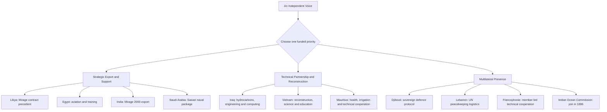

IMPERIA COLD WAR

# France, 1970-1990: Mediterranean and global partnerships

This is a historical design brief for the additional French foreign-policy content. It avoids the West African/Françafrique material covered elsewhere and does not prescribe runtime modifiers. The existing France tree already has 35 recipient-approved offers, including Airbus, Concorde, Symphonie, Ariane, Jaguar, US/Soviet research, Algeria, Iran, Senegal, Rhine/Italy and EEC cooperation. Treat the ideas below as a compact extension or a replacement shortlist, not a second copy of those offers.

## Historical precedents usable in design

| Date and precedent | What the record establishes | Design use and real trade-off |
|---|---|---|
| **1970, Libya Mirage contract** | President Pompidou personally informed President Nixon that a contract had been completed for 100 French aircraft, including Mirage fighters, with deliveries beginning in 1970 and continuing through 1974. This is a contemporary US National Archives memorandum, not an inference from later summaries. [FRUS, 19 January 1970](https://history.state.gov/historicaldocuments/frus1969-76v41/d136) | A real early export/defence offer can fund French aerospace orders and training. Attach continuing maintenance, instructor and spare-parts commitments, plus diplomatic exposure to regional escalation. Do not portray it as an uncomplicated pro-Arab alignment: the aircraft scale and possible use against Israel caused immediate concern. France's contemporary end-use condition on Libyan Mirage aircraft is reported in a 1973 government denial. [JTA, 13 April 1973](https://www.jta.org/archive/france-denies-mirages-sold-to-libya-are-being-transferred-to-egypt) |
| **1970-1976, Mauritius civilian cooperation** | France and Mauritius signed a Cultural and Technical Cooperation Agreement at Port Louis on 22 June 1970, published by French decree in 1974. A Mauritius government treaty list also records French food aid, health support for Rodrigues, and irrigation/diversified-crop project financing in 1970. [Legifrance, Decree 74-22](https://www.legifrance.gouv.fr/jorf/id/JORFTEXT000000510494), [Mauritius government agreements list](https://goc2020.govmu.org/attorney/wp-content/uploads/2025/07/Agreements-MoUs-sn.pdf) | A distinctly civilian option can deliver agricultural extension, island health service and technical education with a named government's consent. Its trade-off is a small, dispersed programme with recurring field staff and grant costs, rather than a major arms-export return. Do not convert this into automatic control over Mauritius or Reunion's ports. |
| **1970, Iraq cultural/technical basis** | The France-Iraq cultural agreement entered into force in December 1969 and specifically provides for expert/teacher missions, student admission, scholarships and joint selection. [UN Treaty Series, Agreement 10739](https://treaties.un.org/doc/Publication/UNTS/Volume%20748/v748.pdf) | A credible student/engineering exchange offer can be available from the start date. Use scholarships, technical research or civilian training outcomes; the trade-off is French-funded places and expert time. This is a real programme distinct from the later oil and defence contracts. |
| **1972-1975, Iraq hydrocarbons and industrial cooperation** | The French Senate's official list of agreements dates the hydrocarbons exchange of letters to 18 June 1972, economic and technical cooperation to 12 March 1974, information technology cooperation to 11 September 1975, and additional sectors thereafter. [French Senate, treaty inventory](https://www.senat.fr/rap/l10-125/l10-1256.html) | A recipient-approved energy-engineering, industrial training or computing package is historically grounded. Give France a bounded industrial/research benefit and Iraq a visible technical asset or service; charge both sides, and do not award France resource production or assume Iraq grants oil access. Commercial dependence and exposure to Iraqi political change are genuine strategic risks. |
| **1973-1974, Egypt receives French Mirage aircraft** | SIPRI's contemporary yearbook lists Egyptian aircraft supplied through Kuwait and Saudi Arabia after the 1973 war, including Mirage deliveries in 1973-74. [SIPRI Yearbook 1975](https://www.sipri.org/sites/default/files/SIPRI%20Yearbook%201975.pdf) | A later French-Egyptian aviation/training offer can represent restoration of French access to a major regional market. Keep transfer routes and timing legible, and treat resale/end-use assurances as negotiated obligations, not automatic recipient concessions. The package can build aerospace export capacity and training ties, at the price of regional diplomatic friction. |
| **1973-1977 and 1989, Vietnam relations and reconstruction** | French diplomatic records identify the Paris Peace Accords on 27 January 1973, elevation of the French delegation in Hanoi to embassy on 6 June 1973, a cooperation agreement with the Socialist Republic of Vietnam signed 27 April 1977 and renewed in June 1989, and files on aid, assistance and reconstruction. [French Diplomatic Archives, Hanoi delegation](https://archivesdiplomatiques.diplomatie.gouv.fr/ark%3A/14366/dmbxtl1nrkh6), [French Diplomatic Archives, 1970-1990 record](https://archivesdiplomatiques.diplomatie.gouv.fr/ark%3A/14366/1v6px9bfcnl7) | Use a long-horizon civilian reconstruction, medical/engineering or education offer rather than pretending France directed Vietnam's postwar recovery. Recipient gets a named, useful development package; France pays for missions and materials and accepts slow returns and dependence on Hanoi's priorities. Paris's conference role gives diplomatic context, not ownership of the peace settlement. |
| **1977, independent Djibouti and French forces** | On independence day, 27 June 1977, France and Djibouti signed a provisional protocol defining the stationing conditions of French forces after independence and principles of military cooperation. The text is registered in the UN Treaty Series. [UNTS I-24252](https://treaties.un.org/doc/Publication/UNTS/Volume%201430/v1430.pdf) | This supports an explicitly sovereign, renewable defence/access agreement and a durable military-logistics relationship. Make the host's acceptance decisive and fund French personnel/logistics. Avoid a colonial possession or unilateral permanent-base focus; the treaty is a post-independence compact. |
| **1978, French contribution to UNIFIL in Lebanon** | The UN records the French infantry contingent and its engineering, supply, transport and maintenance units in UNIFIL beginning in March 1978. The mission mandate was to confirm Israeli withdrawal, restore international peace and security, and assist the Lebanese government to re-establish authority. [UNIFIL fact sheet](https://peacekeeping.un.org/en/node/104032), [UN mission profile, 1985](https://digitallibrary.un.org/record/118480/files/%5EST_%5EDPI_850--DPI_850-EN.pdf) | A UN-mandated logistics/peacekeeping path can reward expeditionary logistics, engineer and transport capacity, not generic influence. Its costs are deployment capacity and casualty/political risk; mandate ambiguity and dangers to French troops were real, and the force could not simply impose Lebanese sovereignty. |
| **1980, Saudi Sawari naval agreement** | SIPRI dates the Sawari agreement to 14 October 1980 and describes French provision of a package of ships, weapons/sensors and associated support. The later US Army history records the major 1980 modernization contract and its role in a long French support relationship. [SIPRI Yearbook 1981](https://www.sipri.org/sites/default/files/SIPRI%20Yearbook%201981.pdf), [US Army Center of Military History](https://history.army.mil/portals/143/Images/Publications/catalog/45-2.pdf) | A major naval export path is a real way to deepen shipbuilding, electronics and naval training. It needs a large recipient-approved acquisition, French training and long maintenance/logistics capacity, and creates dependence on a wealthy buyer and its political choices. Do not treat contract value as French GDP or give the French navy free ships. |
| **1982-1986, India Mirage 2000 purchase** | India's official parliamentary record confirms that the Mirage 2000H/TH were the 1982 version and that the government contracted for them from France; its 2000 answer does not disclose price under contract secrecy. SIPRI also identifies the 1982 Indian acquisition amid French export growth. [Rajya Sabha written answer, 22 November 2000](https://rsdebate.nic.in/bitstream/123456789/9419/1/PQ_191_22112000_U258_p57_p57.pdf), [SIPRI Yearbook 1984](https://www.sipri.org/sites/default/files/SIPRI%20Yearbook%201984.pdf) | A non-aligned Asian aviation market can reward aircraft research/export capacity and technician training. Keep purchase numbers/costs out of game text unless independently verified; a real programme would require delivery and spare-support commitments, and India retained sovereign procurement choice. |
| **1982-1986, Indian Ocean Commission** | Madagascar, Mauritius and Seychelles began regional cooperation in 1982; the Victoria Agreement institutionalised the Commission on 10 January 1984. Comoros and France, through Reunion, joined in 1986. [Commission de l'océan Indien, membership/history](https://www.commissionoceanindien.org/presentation-coi/etats-membres-coi/), [COI, 35 years of Victoria Agreement](https://www.commissionoceanindien.org/la-coi-celebre-les-35-ans-de-laccord-general-de-cooperation-institutionnalisant-lorganisation/) | This gives a regional, multilateral Indian Ocean branch: fisheries, disaster response, marine science or public-health coordination. Do not grant France membership as of 1970 or call it a French-led organization; the initial initiative belonged to island governments and France joined only in 1986 as Reunion. Costs are shared commitments and negotiation among equal members. |
| **1970 onward, institutional Francophonie** | Twenty-one governments signed the Niamey Convention creating the Agency for Cultural and Technical Cooperation (ACCT) on 20 March 1970. Its stated purpose was cultural and technical cooperation among members, not a French alliance. [OIF official history](https://www.francophonie.org/une-histoire-de-la-francophonie-23), [1970 Convention text](https://www.francophonie.org/sites/default/files/2019-09/acct-textes-fondamentaux-1970-convention-et-charte-3.pdf) | Best used as a multilateral scholarship, publishing, teacher-training and technical-institute route where France participates with rather than commands member states. Fund programme seats and expertise; a tangible shared outcome is language/training/research capacity, while France receives an institutional channel rather than forced recipient alignment. |

## Compact visual proposal

Each top-level route is an exclusive French strategic priority. Its named agreements remain separate recipient-approved focuses; signing one must never make the partner accept another. This uses the current tree's consent model and keeps national funding and partner outcomes inspectable.

**Branch distinction:** defence exports create aircraft/naval orders, specialist training and long maintenance obligations; civilian partnerships produce technical facilities and trained personnel but tie up public funds over longer periods; multilateral work creates French engineering/logistics capacity and shared institutions, while limiting unilateral control. These are counterfactual selectable programmes based on real precedents, not claims that the government of January 1970 had already executed future agreements.

**Implementation boundary for the design team:** partner construction, research, equipment or service benefits should appear in both countries' complete “If they accept” previews. Use each payer's own GDP for setup and weekly costs, and use yearly project totals converted to weekly units. Only France's policy focus should unlock the offer; the named RP recipient decides. Existing indefinite agreement guards (both countries exist, peace, no native embargo or any mirrored sanction, required parent agreement active) should apply unchanged. Foreign offers should not award mines or raw production. The 1970 start can access historical 1970 agreements; later precedents should be gated by their plausible political/technology/date milestones, not appear as accomplished facts on day one.

## Source and authorship record

Prepared as an original research synthesis for IMPERIA COLD WAR using the linked public treaties, official histories, parliamentary records, United Nations records and SIPRI yearbooks. No third-party prose, images or code are reproduced. Source owners and reuse licences vary by link; a separate licence grant for this synthesis is unknown and is not implied. No modifications were made to game files.
