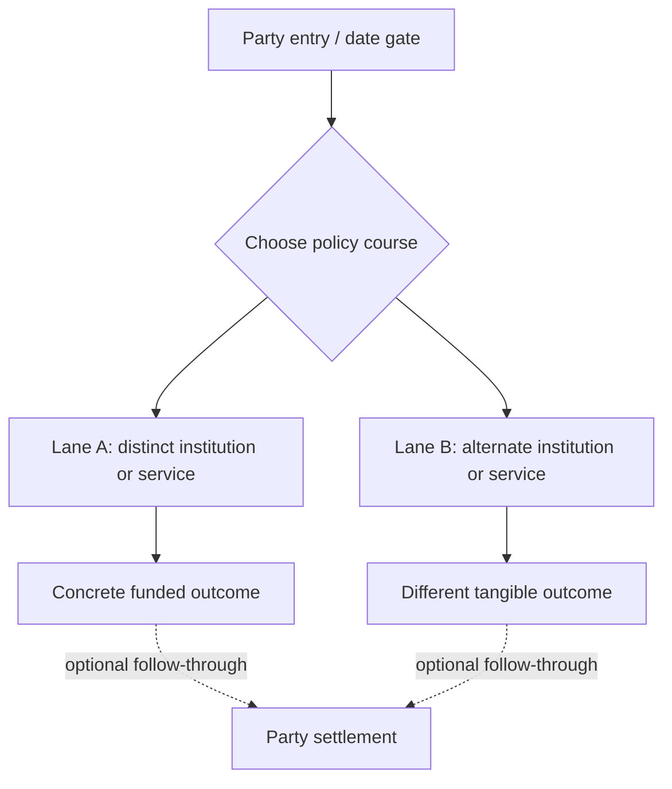

IMPERIA COLD WAR

# France's non-UDR party programmes: historical follow-through ideas

Read against the eight non-UDR programme groups in `tools/france_1970_runtime/runtime_design.json`. This is historical design research only; no runtime, concept or approval file was changed. The ideas below are additional domestic-policy outcomes or dated branches, not a rewrite of the current 16 party pacts. Each party has a distinct governing identity, institutions that could deliver it, and different trade-offs. Exact game costs and modifiers are balance decisions, not historical measurements.

## Candidate programmes

### Independent Republicans (RI)

**Historical frame:** Giscard's RI was a liberal-conservative current with access to the government after 1969 and the presidency from 1974. It had an actual choice between correcting financial discipline and supporting private investment, not a record of governing France from the January 1970 start.

- **`business` / `credit_expansion`: SME equipment finance and credit guarantees.** The finance problem was real: a 1961 Senate report described small and medium firms as often lacking own capital, making otherwise productive investment difficult to finance. A follow-through can route equipment loans, leasing or export-credit insurance toward small suppliers and provincial firms, separate from existing champion-firm procurement. The concrete reward is a specialized finance window or a domestic SME investment programme; the trade-off is public risk if borrowers fail. [Senate report on SME credit, 1961](https://www.senat.fr/rap/1961-1962/i1961_1962_0247.pdf); [Ministry of Economy, COFACE export insurance](https://www.economie.gouv.fr/saef/tresor-assurance-credit-au-commerce-exterieur).
- **`sound_franc`: Barre stabilization, then a later liberal-reform fork.** Date a monetary and price-stability programme to the 1976 Barre turn: credit restraint and expenditure control could preserve the franc and investor confidence, but limit domestic demand. A distinct post-1981 liberal-right government option can privatize specified public holdings or open regulated services, with sale proceeds and competition as rewards and loss of state control as a political cost. This is a later RPR-UDF coalition course, not an RI government. Avoid turning either direction into a generic productivity percentage. [French government chronology of Giscard's Chirac and Barre governments](https://www.info.gouv.fr/les-anciens-premiers-et-premieres-ministres-de-la-ve-republique/jacques-chirac-1974-1976); [National Assembly, 1986 cohabitation and privatization conflict](https://www2.assemblee-nationale.fr/sycomore/fiche/5312).
- **`business` (later branch): artisan and independent-commerce modernization.** Training, bookkeeping and equipment assistance can help independent firms adapt to supermarkets without copying the CID's tax revolt. The 1973 Royer law's stated aims balanced freedom to establish businesses with avoiding the crushing of small firms and preserving commercial life in towns and rural areas. It is a dated 1973 option, not RI's January 1970 baseline. [Légifrance, 1973 Commerce and Crafts Orientation Law](https://www.legifrance.gouv.fr/loda/id/JORFTEXT000000509757).

### Democratic Centre (CD) and Centre Démocratie et Progrès (CDP)

**Historical frame:** Keep CD opposition centrism under Lecanuet distinct from Duhamel's pro-Pompidou CDP. These were separate parties in 1970. Use family and local services as a Christian-democratic identity, not another route to liberal credit or another cross-border pact.

- **`social_market` / `mutuals`: family-service network.** Lecanuet's 1965 campaign explicitly advocated crèches, nursery schools, kindergartens and youth organizations so women could choose work with practical childcare support; he also framed family allowances as a support for choice. A later centre government can co-finance municipal crèches, preschool places and after-school care. Its recurring cost is service staffing and local operating support; its social effect is broader access to work and education. Date this as a developed programme, not an already completed national entitlement. [Senate biography of Lecanuet and CD chronology](https://www.senat.fr/senateur/lecanuet_jean000442.html); [contemporary report on Lecanuet's family platform, 1965](https://www.lemonde.fr/archives/article/1965/12/01/le-candidat-democrate-recoit-la-presse-feminine_2191802_1819218.html).
- **`regional_councils`: elected regional planning and municipal compacts.** In July 1970 the CD studied a plan for roughly nine to eleven larger regions with directly elected proportional assemblies and elected executives, and also proposed a broad mayor-led municipal reform. A tangible reward is regional development offices and municipal co-funding authority. The trade-off is a smaller Paris role and less uniform investment direction. This is a documented CD proposal and can be an early reform alternative; the 1972 regions law and 1982 decentralization remain later legal milestones. [Contemporary account of the CD's July 1970 regional and municipal proposals](https://www.lemonde.fr/archives/article/1970/07/18/le-centre-democrate-approuve-l-idee-d-un-programme-municipal-des-reformateurs_2651981_1819218.html); [Interior Ministry, decentralization chronology](https://www.interieur.gouv.fr/fr/Archives/Archives-des-dossiers/2012-Dossiers/La-decentralisation-a-30-ans).
- **`cdp_compromise`: negotiated social reform inside the majority.** CDP's 1969 declaration set out four planks: development, continuous social dialogue, modernized democracy and European construction. A domestic follow-through can create standing consultations among ministers, employers, unions and local officials, with concrete agendas for work safety, family provision and regional access. The trade-off is that CDP's distinct identity blurs inside the governing majority. [Contemporary report on Duhamel and Fontanet's four CDP planks, 1969](https://www.lemonde.fr/archives/article/1969/12/13/mm-duhamel-et-fontanet-appellent-les-centristes-qui-hesitent-encore-a-rejoindre-la-majorite_2405489_1819218.html).

### Radical Republicans

**Historical frame:** Servan-Schreiber's 1970 Radical Manifesto was unusually broad: it defended enterprise while proposing guaranteed income, redistribution of authority from employers to workers, changed public subsidies, educational change and civilian service instead of compulsory military service. Do not collapse its competing ideas into a generic “modernization” bonus. The 1972 party split is a later fork.

- **`radical_enterprise`: redirect support from corporate incumbents toward individual initiative.** Make selective grants, public procurement access and small-firm equipment support conditional on innovation or apprenticeship, rather than awarding a blanket corporation buff. The benefit is a wider base of new firms; the cost is less predictable returns and a more fragmented industrial structure. This tracks the manifesto's preference for public support that benefited citizens rather than only large companies. The original 197-page manifesto did not itself formally bind the party; the February 1970 congress approved a shorter declaration and amended some proposals. Treat these as an internal programme choice, not unanimous settled doctrine. [Contemporary 1970 account of the Radical Manifesto and congress amendments](https://www.persee.fr/doc/rfsp_0035-2950_1970_num_20_5_418019); [1970 U.S. Senate record summarizing the manifesto's enterprise, guaranteed-income and workplace-power planks](https://www.govinfo.gov/content/pkg/GPO-CRECB-1970-pt20/pdf/GPO-CRECB-1970-pt20-2-1.pdf).
- **`secular_school`: universal preschool and lifelong technical/civic learning.** A Radical branch can add preschool access, adult technical education and public-school facilities, while retaining secular administration. This differs from national universities or CII: it invests in equal entry and continuing education rather than elite research infrastructure. The trade-off is teacher and municipal operating capacity. [Radical Manifesto review, 1970](https://www.persee.fr/doc/rfsp_0035-2950_1970_num_20_5_418019).
- **`left_radicals` / `civil_liberties`: choose a guaranteed-income and civil-service trial, or gradual inheritance reform.** These are distinct, costly social-policy forks named in the 1970 manifesto: a minimum-income guarantee or a redesigned civilian national service in place of conscription; separately, a more progressive inheritance-tax schedule. Present them as contested proposals that require legislation and administrative machinery, not as policies the party had already enacted. The inheritance proposal itself was amended during the party congress, so use a graduated reform rather than confiscation. [Persée, Radical Manifesto and congress amendments](https://www.persee.fr/doc/rfsp_0035-2950_1970_num_20_5_418019).

### Socialist Party (PS)

**Historical frame:** Savary's 1969 PS is institutionally rebuilding. CIR belongs in the story as a separate organization until Mitterrand joined the PS with it at Épinay in June 1971. The 1972 Common Programme and 1981 government programme are later milestones, not starting conditions.

- **`socialist_refoundation`: integrate CIR's club network after Épinay.** The tangible result is a larger local party organization, candidate and municipal-campaign network, and a recognizable presidential opposition. Gate it after the 1971 congress; do not treat the Mitterrand-led, unified PS as already established in January 1970. [National Assembly biography, CIR, PS foundation and Épinay chronology](https://www2.assemblee-nationale.fr/sycomore/fiche/5312).
- **`common_programme` / `public_banks`: a signed domestic coalition platform, followed by public-ownership legislation.** The PS-PCF Common Programme was agreed in June 1972 and left disagreements over strategy visible. Its 1981-era governing follow-through included nationalization of 36 deposit banks and major industrial groups. A gameplay award should be a date-gated ownership transfer or public-investment mandate, with Treasury exposure and management capacity as trade-offs. It should not imply that the PCF's later 1976 doctrinal shift had already occurred. [1972 Common Programme text](https://www.lemonde.fr/archives/article/1972/06/29/le-programme-commun-de-gouvernement-etabli-par-les-delegations-du-parti-socialiste-et-du-parti-communiste-francais_3141472_1819218.html); [National Assembly, Mitterrand's 1981-82 reforms](https://www2.assemblee-nationale.fr/sycomore/fiche/5312).
- **`social_contract_ps`: Auroux workplace rights and annual bargaining.** In 1982, the Auroux laws strengthened worker freedoms, information, consultation and collective bargaining. This makes an excellent real late branch reward: legal workplace rights and bargaining coverage, with more formal negotiation and employer constraints. It is materially different from the 1967 profit-sharing regime and from PSU worker ownership. [Légifrance, 4 August 1982 law on workers' freedoms](https://www.legifrance.gouv.fr/loda/id/JORFTEXT000000504206); [Ministry of Labour chronology of Auroux reforms](https://travail-emploi.gouv.fr/ministere/histoire-du-droit-du-travail/reperes-chronologiques/article/histoire-du-droit-du-travail-de-1841-a-nos-jours).
- **`redistribution` / `defferre`: use the enacted 1981-82 package in discrete steps.** The 39-hour week, fifth paid-holiday week and retirement at 60 came in 1982; the Defferre decentralization laws also transferred practical authority to elected territorial institutions. Make choices sequential and date-gated, with labour cost, pension cost and administrative transition each visible as their own policy cost. [National Assembly report on 1982 working-time reform](https://www.assemblee-nationale.fr/rapports/r0652.asp); [Interior Ministry decentralization chronology](https://www.interieur.gouv.fr/fr/Archives/Archives-des-dossiers/2012-Dossiers/La-decentralisation-a-30-ans).

### French Communist Party (PCF)

**Historical frame:** Local government was a major PCF strength. Municipal practice offers more distinctive tangible content than another generic national industry or party-discipline modifier. Keep the municipal route separate from national public-combine planning and from the PCF's internal democratic/orthodox dispute.

- **`municipal_socialism`: primary-care and prevention network.** Communist-led Saint-Denis built municipal health and maternal-child protection services long before 1970. A national route can fund municipal health centres, dispensaries, maternal-child clinics and public-health staff through local authorities. It improves access and prevention, but creates a durable municipal payroll and requires coordination with national hospitals and social insurance. [Seine-Saint-Denis heritage inventory, Saint-Denis municipal health centre](https://patrimoine.seinesaintdenis.fr/Centre-de-sante-municipal); [Ministry of Health journal, overview of municipal health's historical role](https://www.santepubliquefrance.fr/index.php/en/docs/article/cities-and-health-a-historical-overview-0).
- **`municipal_socialism`: housing, childcare and popular culture as a second service package.** The documented “red municipality” model included public housing offices, sanitation, childcare and education/popular-culture services. A player can broaden this local package instead of making municipal socialism merely a national factory subsidy. The cost is construction and continuing city services; the gain is practical delivery in working-class communes. [French Ministry of Culture, Saint-Denis urban and housing history](https://archeologie.culture.gouv.fr/saint-denis/fr/la-ville-actuelle-et-ses-mutations); [CNRS researcher summary of communist municipal practice](https://projet.pcf.fr/43684).
- **`workers_control` / `public_combine`: informed worker representation versus centralized command.** Add elected workplace representation, access to company plans and consultation on modernization as a specific industrial-governance package. Keep it distinct from PSU-owned cooperatives: PCF's route can strengthen worker voice inside public enterprises while the party and state retain strategic ownership. The trade-off is slower management decisions and conflict over central versus workplace authority. The 1982 Auroux statute provides a later all-party legal precedent for workplace information and freedoms. [Légifrance, Auroux workplace-freedoms law, 1982](https://www.legifrance.gouv.fr/loda/id/JORFTEXT000000504206).

### Unified Socialist Party (PSU)

**Historical frame:** PSU was a smaller anti-authoritarian socialist party. Its self-management doctrine became central at its December 1972 congress; the Lip watch-factory experiment in 1973 gave the idea an influential practical model. Distinguish an experiment with real firm-level governance from a national promise that every worker-run enterprise will succeed.

- **`self_management`: worker-run pilot with a cooperative credit and sales plan.** Offer a limited, legally recognized pilot in a threatened or recently closed firm, with elected worker managers, a working-capital facility and market access. The benefit is workplace initiative and a chance to preserve skilled production; risks are capital shortages, sales uncertainty and internal disputes over authority. Lip's workers resumed watch production and organized their own sales, but this is a precedent for an experiment, not a guaranteed national business model. [CNRS Centre d'histoire sociale, PSU and autogestion](https://histoire-sociale.cnrs.fr/amp/le-psu-et-lautogestion/); [Fondation Jean-Jaurès, Lip and self-management](https://www.jean-jaures.org/publication/juin-1975-le-parti-socialiste-et-lautogestion/).
- **`union_autonomy`: union-run training, legal advice and safety institutes.** Build practical institutes where unions train workplace delegates in bargaining, health and safety, and works-committee review. Unlike a foreign cooperative pact, the outcome is a French civil-society institution; unlike PCF public combines, it does not transfer the firm to the state. The cost is recurring public or dues-based funding and potential employer resistance. Later law gives worker representation and occupational safety a concrete legal analogue. [Ministry of Labour, 1982 Auroux laws](https://travail-emploi.gouv.fr/ministere/histoire-du-droit-du-travail/reperes-chronologiques/article/histoire-du-droit-du-travail-de-1841-a-nos-jours).
- **`grassroots_left` / `decentralised_services`: user-governed neighbourhood services.** A PSU-led municipality could pilot local cultural, childcare or adult-learning centres where residents and users share decisions. This turns anti-authoritarian participation into a visible service institution without duplicating national social spending or university expansion. Treat it as a counterfactual local policy under PSU government, not a claim that the small party ran a national system.

### Political Ecology

**Historical frame:** Ecology was an emerging movement, not a mass party in January 1970. A real French government action preceded the environment ministry: Chaban-Delmas requested interministerial work on environmental harms in October 1969; the “100 measures” programme was presented in June 1970; Robert Poujade became the first environment minister in January 1971. This supports a staged path from oversight to a durable ministry.

- **`environment_account` / `ecological_industry`: river-basin monitoring and discharge clean-up.** Extend the six river-basin agencies created under the 1964 water law with local sampling, wastewater-treatment grants and enforceable industrial discharge standards. Water-quality monitoring and clean-up are tangible, place-based outcomes unlike generic environmental awareness. Costs fall on municipalities and plants; tighter discharge rules can delay or require industrial upgrades. [Légifrance, 1964 water law establishing basin agencies and grant powers](https://www.legifrance.gouv.fr/loda/id/JORFTEXT000000509753/1964-12-18); [Seine-Normandie Water Agency, initial pollution survey and wastewater priorities from 1968](https://www.eau-seine-normandie.fr/sites/public_file/FICHES_RESUMES/14-EVAL-01_50_ans_politique_eau_2014.pdf).
- **`efficiency_ecology` / `local_generation`: municipal heat-network extension and retrofit.** Urban heat networks already expanded during 1955-75, usually from coal or fuel oil. An ecological government can connect dense housing and public buildings to managed heat networks, insulation and later waste-heat use. Distinguish initial local air-quality and distribution benefits from post-1973 fuel diversification; do not claim early networks were already low-carbon. [French government urban heat-network history](https://france-chaleur-urbaine.beta.gouv.fr/ressources/histoire); [Ministry of Economy, history of the 1982-86 post-oil-shock multi-energy heat-network support](https://www.economie.gouv.fr/files/files/directions_services/dgccrf/boccrf/99_15/a0150002.htm).
- **`environment_account`: environmental administration with real staff and enforcement.** Expand the 1970 “100 measures” into a funded directorate/ministry with inspection, impact review and local grants. This is a more credible staged reward than an instant national nature-preservation modifier; its weakness is the historically thin staff and budget of the first Environment Ministry. [Ministry of Ecological Transition, 100 Measures programme and 1971 ministry](https://www.ecologie.gouv.fr/sites/default/files/documents/HS%20n%C2%B034%20100%20mesures%20pour%20l%27environnement.pdf).

### CID and the later Front National (FN)

**Historical frame:** The January 1970 party identity is Pierre Poujade's CID, rooted in independent shopkeepers and anti-tax mobilization. The FN was founded in 1972 and remained electorally marginal for most of this horizon; it won a notable 35 seats in 1986. Any national FN governing programme is therefore a major alternate-history condition, not a historical government precedent.

- **`cid_cooperatives`: shared wholesale buying, bookkeeping and succession services.** Give small shops and artisans voluntary purchasing cooperatives, pooled accountancy and training for store succession. This helps independents compete on supply terms and compliance rather than simply cutting taxes; it has administrative and public-guarantee costs. The 1973 Royer law later formalized a national concern with preventing the crushing of small businesses while regulating new commercial space. [Légifrance, 1973 Commerce and Crafts Orientation Law](https://www.legifrance.gouv.fr/loda/id/JORFTEXT000000509757); [Government report on independent commerce and the 1973 law](https://www.vie-publique.fr/files/rapport/pdf/278975.pdf).
- **`cid_tax`: distinguish immediate tax protest from a durable small-business settlement.** One choice can lower or simplify a narrow class of small-business charges; another can retain revenue but give registered small firms access to bookkeeping and training services. The trade-off should be forgone public receipts versus a better-supported retail network, not an unexplained flat opinion penalty. The Commerce and Crafts law's 1973 training provisions are a dated precedent for the latter.
- **`fn_protection` / `fn_state`: alternate-history national preference.** Only after the party clears a plausible 1980s electoral breakthrough should a governing FN branch offer preferential public procurement and domestic-content rules, and an executive/immigration regime presented explicitly as a controversial counterfactual. The tangible industrial reward is guaranteed public demand; costs include exclusion of workers, reduced imports/competition, retaliation and conflict with republican rights. Do not describe CID's 1970 shopkeeper constituency as already holding this national FN programme. [National Assembly chronology of Mitterrand, the 1986 FN parliamentary breakthrough and first cohabitation](https://www2.assemblee-nationale.fr/sycomore/fiche/5312).

## Compact branch visualization

The current party anchors in the runtime layout are spaced at x = 29, 39, 49, 59, 69, 79, 89 and 99. A compact shared geometry can keep each new political programme visually distinct: one dated entry node, a two-way fork, one or two nodes in each policy lane, then an optional closing focus. Keep each party module within about four focus columns around its existing anchor (x ±2), so adjacent ten-column party intervals do not collide. The content of the lanes remains party-specific; this is only a spatial suggestion.

## Factual versus counterfactual guardrails

- Historical milestones: 1970 Radical Manifesto; 1970 CD regional and municipal proposal; 1971 CIR/PS integration at Épinay; 1972 Common Programme and PSU autogestion doctrine; 1973 Royer law and Lip experiment; 1981 PS government; 1982 Auroux and Defferre reforms; 1986 FN representation in Parliament; 1988-90 ecological and industrial restructuring debates.
- Counterfactuals: any RI, CD, Radical, PS, PCF, PSU, ecology or FN national government outside its actual office-holding period; nationwide extension of a party's local policy; and all branch combinations not historically enacted.
- Prefer concrete outputs that sources establish: services, credit facilities, legal rights, local bodies, investment programmes, public ownership transfers, research/monitoring capacity. Do not claim a source establishes exact HOI modifier values, GDP charges or national effects at the scale of a focus reward.

